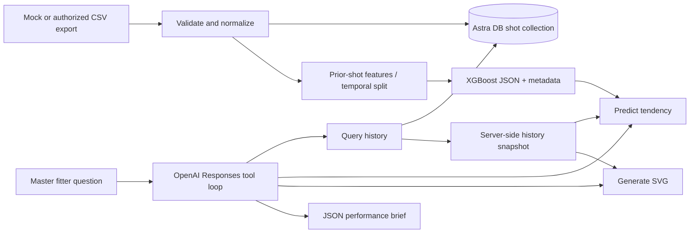

# Golf Analytics & Performance Agent

A modular Python prototype for a master fitter: retrieve player history, classify observed driver delivery, generate editable SVG evidence, and return a structured performance brief. The sample is **synthetic, right-handed, driver-only**; the requested CSV has no club or handedness column, so it cannot safely mix clubs or handedness.

## Architecture



Enterprise Design Thinking comments identify the **master fitter** persona and an observable outcome: review recent delivery tendencies and chart evidence, then select a measurable fitting trial. The workflow follows observe, reflect, make. Validate this outcome with fitters before broadening automation.

## Run locally

Python 3.11+ is required. From the project directory:

```bash
python3 -m venv .venv
source .venv/bin/activate
python -m pip install -e .
export MPLCONFIGDIR="$PWD/.mplconfig"
python -m golf_agent.cli demo
python -m unittest discover -s tests -v
```

`demo` generates 720 shots, trains and reloads the classifier, predicts Player A's latest shot, and exports two SVGs plus `artifacts/demo.json`. It is deterministic apart from chart filenames and does not call OpenAI or Astra DB. It regenerates mock data and model artifacts, so use separate paths for real data.

If XGBoost reports a missing `libomp` on macOS, install the OpenMP runtime using your environment's package manager.

## Configure services and execute the agent

Fill in `.env` using `.env.example`, or set environment variables using your shell or secret manager. The CLI automatically loads `.env` from the current working directory; existing shell variables take precedence. Choose an available OpenAI model supporting Responses function calling and structured outputs; no account-specific model is assumed.

```bash
export OPENAI_API_KEY='your-key'
export OPENAI_MODEL='your-supported-model-id'
export ASTRA_DB_API_ENDPOINT='https://your-database-endpoint'
export ASTRA_DB_APPLICATION_TOKEN='your-application-token'
export ASTRA_DB_COLLECTION='trackman_shots'

python -m golf_agent.cli generate
python -m golf_agent.cli train
python -m golf_agent.cli ingest
python -m golf_agent.cli chat --prompt "Analyze Player A's driver data and tell me if a stiffer shaft would reduce their spin rate, and generate a chart"
```

Create an Astra DB Serverless database and use its Data API endpoint and token with collection creation/read/write permissions for ingestion. Inference can use a separate read-only token. Ingestion creates a standard non-vector collection with default indexing. Deterministic player/timestamp IDs make upserts repeatable; ingestion may partially complete on a network failure, and rerunning resumes safely. Corrected measurements replace the same shot. For larger volumes, adopt bulk upserts and record ingestion checkpoints.

For an OpenAI run without Astra, use `chat --backend local`. Without `--prompt`, it asks for one natural-language query. Each invocation is a bounded analysis turn; persistent memory is the stored shot history, not conversational memory. Agent tools never run arbitrary shell commands or accept raw database filters. All model inputs come from a server-side history snapshot referenced by `history_id`.

## Files and contracts

| File | Purpose |
| --- | --- |
| `golf_agent/data.py` | Seeded CSV generator, validation, Requests HTTPS export adapter |
| `golf_agent/ml.py` | Feature engineering, synthetic labels, chronological evaluation, saved model |
| `golf_agent/store.py` | Astra DB insertion/query and explicit local alternative |
| `golf_agent/charts.py` | Matplotlib/Seaborn SVGs with editable text |
| `golf_agent/contracts.py` | Strict function and final-brief JSON schemas |
| `schemas/tools.json` | Ready-to-inspect OpenAI function declarations |
| `schemas/brief.json` | Structured performance brief schema |
| `golf_agent/agent.py` | Function dispatch, tool results, bounded Responses execution loop |
| `golf_agent/cli.py` | Generate/train/ingest/demo/chat entry points |
| `tests/test_pipeline.py` | Leakage, validation, serialization, SVG and mocked-service tests |

Regenerate JSON contracts with `python -m golf_agent.cli schemas`. Tool calls are `query_player_history(player_id, limit)`, `predict_swing_tendency(history_id)`, and `generate_performance_chart(history_id, kind)`. Training and ingestion are operator commands, not model-controlled mutations.

The brief contains `player_id`, `summary`, `evidence`, `swing_tendency`, `equipment_assessment`, `charts`, `limitations`, and `next_steps`. Equipment assessment explicitly cannot estimate shaft effects. Function arguments and final JSON are validated locally as well as constrained at the API. The runtime handles tool errors as safe JSON, preserves response items and call IDs, checks incomplete responses, and caps tool rounds. Production callers should capture the returned JSON and artifact paths in their application storage.

## Data science assumptions

- Units: club speed in mph, angles in degrees, spin in rpm, carry in yards. Dates are UTC shot timestamps, unique per player. Exact columns: `Player_ID, Date, Club_Speed, Attack_Angle, Club_Path, Face_Angle, Dynamic_Loft, Spin_Rate, Carry_Distance`.
- Face-to-path = face angle minus club path. The simplified spin-loft feature = dynamic loft minus attack angle; it is not a full 3D measurement.
- Prior-five-shot means are shifted **within player** before rolling. They never include the current shot, future shots, or another player. No backward fill or full-dataset imputation is used. Missing early history remains NaN for XGBoost.
- A global time cutoff reserves the last 20% of unique timestamps. Later test shots may use previously observed test-shot measurements, matching sequential online analysis. This evaluates observed-shot classification, not next-shot prediction. The saved model is the evaluated training-period model, with its metadata.
- The three targets are illustrative delivery rules: negative path below -3° with face-to-path above +3° is slice-prone, positive path above +3° with face-to-path below -3° is hook-prone, and other shots are neutral-delivery. These are demo labels, not measured flight or authoritative diagnoses. Their derivation from inputs makes the evaluation a rule-approximation check, not independent model validation. Replace them with independent expert labels, and add player/session holdouts, class metrics and calibration before real use.
- The generator's spin/carry relationship is invented for demonstration. `spin_carry` is an observational scatterplot; `delivery_groups` plots delivery geometry using synthetic rule labels. Neither chart claims an optimal spin curve or measured ball-flight dispersion. Those require additional launch and flight measurements.
- There is no shaft flex, shaft model, mass, torque, head setting, strike location or trial assignment. A stiffer shaft's effect is therefore **not identifiable** from this dataset. The agent should propose randomized within-player equipment trials controlling head, ball, conditions and fatigue, collecting repeated shots, strike location and equipment metadata. Build an equipment model only after collecting appropriate evidence.

## Prototype boundaries

No live TrackMan API is claimed. `fetch_csv` is an operator-invoked Requests adapter for an authorized CSV download with timeout, retry, size and schema checks. Add an allowlist for your export host before exposing it through a service.

Astra scalar sorting has service limits; use bounded player/session date ranges or a time-series access design when histories grow. This prototype retrieves at most 200 shots and reports its scope. Add `Club`, `Handedness`, `Shot_ID`, `Session_ID`, equipment and measurement-quality fields before real mixed-club use, and group rolling features accordingly.

Before multi-user deployment, add authenticated fitter/player authorization, tenant scoping, consent and retention rules, artifact storage/access controls, request-level audit IDs, pinned dependencies and model versions, and live-service integration tests. Tool schemas constrain shape, not factual correctness: review generated briefs with the fitter. Local tests use mocked OpenAI/Astra interfaces and cannot establish account access or service compatibility.

## Official API references

- [OpenAI function calling](https://developers.openai.com/api/docs/guides/function-calling)
- [OpenAI structured outputs](https://developers.openai.com/api/docs/guides/structured-outputs)
- [Astra collection creation](https://docs.datastax.com/en/astra-db-serverless/api-reference/collection-methods/create-collection.html)
- [Astra Python collection API](https://docs.datastax.com/en/astra-api-docs/_attachments/python-client/astrapy/collection.html)
- [XGBoost model serialization](https://xgboost.readthedocs.io/en/stable/tutorials/saving_model.html)

## Streamlit dashboard

See [app/README.md](app/README.md) for installation and usage. Start the local dashboard with:

```bash
.venv/bin/python -m streamlit run app/dashboard.py --server.address localhost --browser.gatherUsageStats false
```

Select a player from Astra DB, ask a question, and review/download the brief and SVG charts. All Streamlit-specific code, dependencies, documentation, and UI tests live in `app/`.
